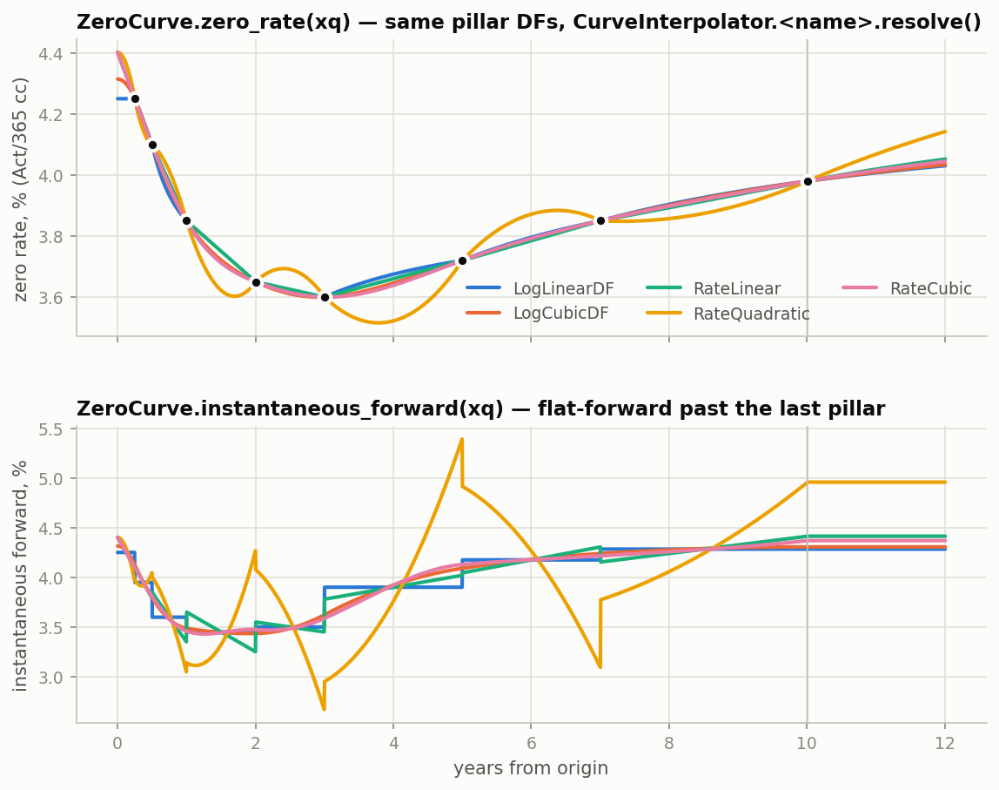
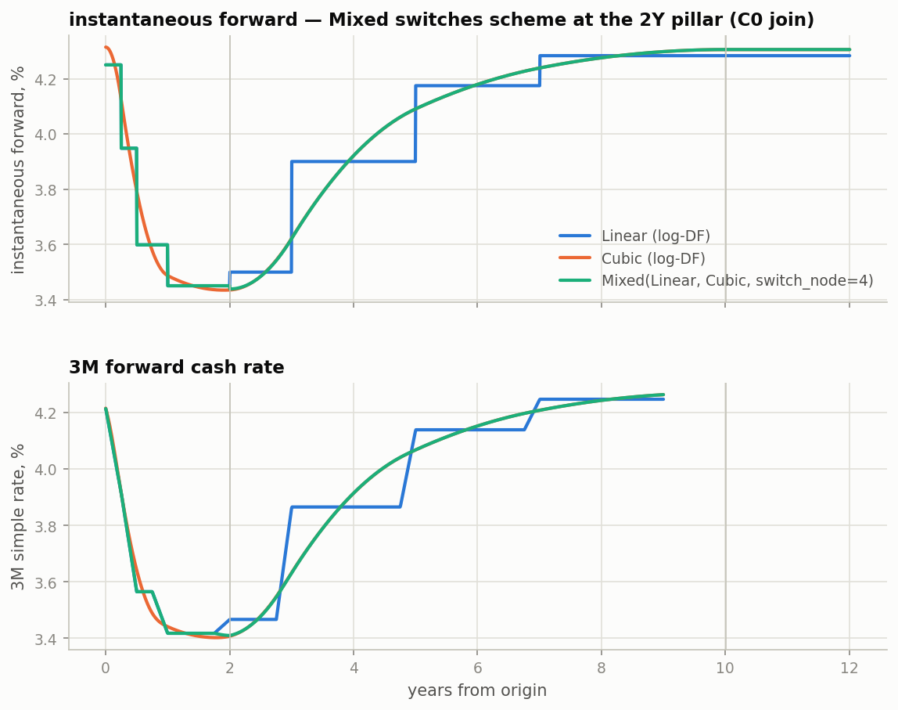

# Curve and Rate Architecture

Responsibilities and boundaries. For usage, snippets and figures see
[curves_line1d.md](curves_line1d.md); for one document per object with runnable snippets, and
the mathematics behind them, see [curves/](curves/README.md).

The curve stack separates mathematical state from market meaning. A calibrated curve is not
itself a SOFR curve: it becomes one only after SOFR's index conventions are attached.

```text
calibration quotes
       |
       v
   Line1d                common.math: nodes + interpolator + per-side extrapolation
       |
       | in log-DF or zero-rate space, DF invariants
       v
   DiscountCurve         protocol: ZeroCurve (atom) | CompositeCurve (weighted sums in log-DF)
       |
       | + origin date + USD SOFR conventions
       v
   YieldCurve            dates, conventions + optional historical fixings
       |
       v
   MarketContext         registry of yield curves and vols
       |
       v
   RateGenerator         forwards, compounded/averaged rates, and par rates
       |
       v
   PricingProgram        NumPy / Numba / JAX valuation and risk
```

## Responsibilities

`ZeroCurve` is pure curve math on float day offsets (`x[0] == 0`, `dfs[0] == 1`). It is a
`common.math.line.Line1d` in a declared `CurveSpace` (`LogDF` or `ZeroRate`) with any
`common.math.interpolation` scheme (`Linear`, `Cubic(bc_type)`, `Quadratic`, `Mixed`, ...),
plus the discount-factor invariants. Its public queries all take day offsets:

- `discount_factor(x)`, `log_discount_factor(x)`
- `zero_rate(x)` (continuously compounded on the curve's Act/365 clock)
- `instantaneous_forward(x)`
- `with_dfs(dfs)` rebinds node values without refitting the geometry checks (the
  calibration and bump-and-reprice hot path); `line.coefficients` is the engine hand-off

It has no dates, currency, index, fixing, forward-rate, coupon, or par-rate behavior.
`CurveInterpolator` (`LogLinearDF`, `RateCubic`, ...) is a parse table for config and Excel;
`resolve()` gives the `(space, interpolator)` pair.

`DiscountCurve` is the runtime-checkable protocol `ZeroCurve` satisfies and that everything
downstream consumes: geometry (`x`, `dfs`, `max_x`, `scheme`), a flat parameter vector
(`params`, `with_params`), the queries above, and `log_df_affine`, the exact
`(offset, jacobian)` of `ln DF` in the parameters that the engines differentiate through.
`CompositeCurve(components, weights)` is `ln DF = Σ wᵢ ln DFᵢ` over any discount curves (spreads,
basis curves, turns, overlays; composites nest). Components may be labelled
(`{"base": sofr, "spread": ZeroCurve.constant(-0.0005, sofr.max_x)}`) and addressed by label.
It is exactly affine in its concatenated parameters, so a composite prices and risks through
the engines unchanged. The engines lay parameters out by ownership (`ParamLayout`, one block per
owning key, each atom once), so a shared atom is reported once however many composites reach it:
the SOFR ladder of a Fed Funds swap is one ladder and the Fed Funds ladder is the basis.

`YieldCurve` composes an `origin` date and one `DiscountCurve` with a curve key
(`finance.conventions.CurveKey`) and optional `HistoricalFixings`. It is the only layer that
sees dates: `discount_factor(dates)` etc. convert through `dates_to_x(origin, dates)`;
`node_dates` and `node_index(Term | date)` map pillars back to the calendar. Keys follow one
grammar: `CCY.INDEX.TENOR` is a projection curve (`USD.SOFR.1D`, `USD.CME-TERM-SOFR.3M`; it
carries its index family's conventions) and `CCY.NAME` is a discount curve (`USD.STDCSA`,
`USD.UST`; no conventions, nothing resets off it). `YieldCurve.build(node_dates, dfs, ...)` is
the dates-in constructor; `with_zero_curve(...)` creates a scenario curve while preserving
origin, key and fixing history; `with_key(...)` re-registers the same state under another key.

`MarketContext` owns registered market data. It is a `Mapping[str, DiscountCurve]`:
`market["USD.SOFR.1D"] = sofr` registers a curve, `market[key]` is the mathematical curve and
`yield_curve(key)` the derived date-aware view. A market registers every key its trades name;
discounting at SOFR is `market["USD.STDCSA"] = sofr`, the same object under the discount key.
Scenarios are frozen copies: `with_curve(key, curve)` moves a curve wherever it appears (every
key holding it and every composite built on it), `bump(key, amount)` shifts the parameters a key
owns, and `leaf_owner()` / `owned(key)` report ownership by shortest path (a registered atom
belongs to its own key; at equal depth a projection key beats a discount key). It does not
calculate rates.

`RateGenerator` gives financial meaning to discount-factor ratios. It generates simple
index rates (including historical-fixing overlays), continuous interval forwards,
compounded and averaged observation rates, and par swap rates. Pricing and calibration
helpers use this layer rather than asking the curve or market to project a rate.

Historical/projected selection uses the curve origin as its only cutover:

```text
fixing date < YieldCurve.origin   -> historical fixing (locked, zero index risk)
fixing date >= YieldCurve.origin  -> projected rate (curve-sensitive)
payment date < YieldCurve.origin  -> expired flow (DF = PV = all risk = 0)
```

`HistoricalFixings` is a date/value series backed by `Line1d` with `Flat` (previous-hold)
interpolation and flat extrapolation on both sides: a Friday print covers Saturday and
Sunday, Monday's print takes over on Monday. Daily compounded coupons may therefore contain both locked observations
and projected observations. Their index delta is naturally the remaining, or "stubbed",
projection risk. A fully historical but unpaid coupon retains funding risk because its future
payment is discounted, while its index risk is zero.

`YieldCurveGroup` is intentionally deferred. `MarketContext` already supports multiple
registered yield curves, which is sufficient for SOFR discounting, Fed Funds projection,
and other current multi-curve cases. A currency-family group should be introduced only when
it has additional behavior or invariants to own.

## Calibration and registration

Calibration returns the solved curve and the market holding it; a key already in the market is
solved in place (the atom it owns moves, everything else is held), which is how a basis curve
registered as `sofr + spread` is bootstrapped:

```python
from finance.dates import Date
from finance.markets.context import MarketContext
from finance.markets.curves import CurveInterpolator
from finance.pricing.calibration import (
    CurveCalibrator,
    CurveDefinition,
    GlobalSolver,
    deposit_helper,
    swap_helper,
)

as_of = Date(2026, 6, 3)
helpers = [
    deposit_helper(rate=0.0361, tenor="3M", as_of=as_of),
    swap_helper(rate=0.0394, tenor="2Y", as_of=as_of),
    swap_helper(rate=0.0399, tenor="7Y", as_of=as_of),
    swap_helper(rate=0.0409, tenor="10Y", as_of=as_of),
]
base = MarketContext(as_of)   # empty: nothing is discounted implicitly
definition = CurveDefinition("USD.SOFR.1D", CurveInterpolator.LogLinearDF, discount_keys=("USD.STDCSA",)
)  # the curve being calibrated also discounts its own swaps
result = CurveCalibrator(helpers, GlobalSolver(), definition).calibrate(
    base,
    jacobian=True,
)

market = result.market                             # USD.SOFR.1D (SOFR conventions attach) and USD.STDCSA: one object, two keys
# Optional for a seasoned book: market = market.with_fixings("USD.SOFR.1D", HistoricalFixings(fixing_dates, fixing_rates))
```

The same boundary is used for scenarios, which are frozen copies:

```python
scenario_market = market.with_curve("USD.SOFR.1D", result.zero_curve.with_dfs(new_discount_factors))
bumped_market = market.bump("USD.SOFR.1D", 1e-4)   # +1bp on every SOFR pillar; USD.STDCSA follows
```

## Pricing and rate generation

```python
from finance.instruments.resolution import Swap
from finance.markets import RateGenerator
from finance.pricing.pricers import SwapPricer
from finance.pricing.risk import NumbaRisk
from finance.pricing.types import Backend

template = Swap.fixed_float_swap(
    notional=100e6,
    rate_index="USD.SOFR.1D",
    fixed_rate=0.0,
    tenor="7Y",
    as_of=as_of,
)
par = RateGenerator(market).par_swap_rate(template)
swap = Swap.fixed_float_swap(
    notional=100e6,
    rate_index="USD.SOFR.1D",
    fixed_rate=par,
    tenor="7Y",
    as_of=as_of,
)

program = SwapPricer().compile([swap], backend=Backend.Numba)
price = program.price(market)
risk = NumbaRisk(program, market)
zero_dv01 = risk.zero_ladder("USD.SOFR.1D")
index_dv01 = risk.index_ladder("USD.SOFR.1D")
funding_dv01 = risk.funding_ladder("USD.SOFR.1D")
gamma = risk.gamma("USD.SOFR.1D")

# risk to the quotes of real instruments: a RiskTemplate view over the same pillar risk
from finance.pricing.risk import RiskEngine, RiskTemplate
template = RiskTemplate.identity(helpers, name="calibration set")   # or any par-swap strip
quote_risk = RiskEngine(program, market, template=template).quote_risk()
quote_risk.dv01            # (1, K): PV change per +1bp of each template quote
quote_risk.unexplained     # (1, P): the pillar risk left after the template hedge
```

For a complete runnable calibration, single-swap report, randomized N-swap aggregation,
and no-recompile scenario recalculation, see
[`research/sofr_curve_calibration.py`](../research/sofr_curve_calibration.py).

## Interpolation scope

`ZeroCurve` accepts any `common.math.interpolation` scheme in either space, including
`Mixed(short, long, switch_node)` for a log-linear front end with a spline beyond a chosen
pillar (`YieldCurve.node_index(Term("2Y"))` resolves the switch). The Numba pricing/adjoint
engine takes any of them: at prepare time each curve hands over `ZeroCurve.log_df_affine` on
the program's static queries — the exact `(offset, jacobian)` of `ln DF` in the pillar zero
rates — and the kernel never sees the scheme. Only the JAX oracle still models log-linear DF
(`ZeroCurve.is_log_linear`). Every bound interpolator also exports PPoly `coefficients` for a
kernel that wants to evaluate the curve itself.

Same pillar discount factors under the five named schemes. Zero rates agree at the pillars;
the forward panel is where the scheme choice shows:



Log-linear front end, natural cubic beyond the 2Y pillar via `Mixed`; the forward is
continuous in DF at the join, not in slope:


