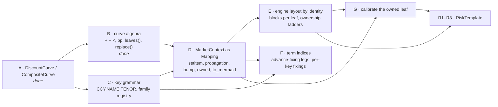

# Curves and market: the next book of work

> **Status: AGREED PLAN (2026-10-14, updated 2026-10-15).** Decisions taken in design discussion on
> `feature/carlos/more_curves`; PRs A and B are implemented on that branch, nothing else is.
> Companion to [risk_and_engine_design.md](risk_and_engine_design.md) (the `RiskTemplate` that
> lands on top of this) and [curves/](curves/README.md) (the user-facing documentation).

## 0. Decisions, so they are not re-litigated

1. **Curves compose only as weighted sums in log-DF, through one class.** `ln DF = Σ wᵢ ln DFᵢ`.
   It is the one composition that keeps `ln DF` exactly affine in the parameters, which is the
   engine contract. Spreads, bases, turns, overlays all fit; nothing non-affine is admitted. A
   spread is `CompositeCurve({"base": a, "spread": b})`, not a class of its own (`SpreadCurve`
   was removed on 2026-10-14 as pure delegation).
2. **Finance vocabulary at the surface, engineering underneath.** Users write
   `market["USD.FEDFUND.1D"] = market["USD.SOFR.1D"] - 5 * bp`. The words atom, group, layout,
   definition, leaf never appear in a public signature or a report.
3. **Sharing is by object identity, declared by construction.** Writing `sofr - 5 * bp` already
   says the Fed Funds curve is built on `sofr`. The engine deduplicates parameter blocks by the
   identity of the leaf curves it reaches; no name-based definitions table.
4. **A registered name owns the parameters nobody else owns.** `ladder("USD.SOFR.1D")` is all
   SOFR pillar risk however it arrived; `ladder("USD.FEDFUND.1D")` is the basis. A leaf reached
   by several names belongs to the one reaching it by the shortest path; an equal-depth tie on
   an unregistered leaf is a bind-time error.
5. **Scenarios propagate.** Replacing or bumping a curve rebuilds every registered curve that
   contains it. "Bump SOFR" moves Fed Funds and leaves the basis alone, because that is what the
   definition says.
6. **Curve key grammar is `CCY.NAME[.TENOR]`.** Tenor is present exactly when the thing has a
   designated maturity (`USD.SOFR.1D`, `USD.CME-TERM-SOFR.3M`); issuer curves have none
   (`USD.UST`). Conventions are registered per **family** with its admissible tenors; the tenor is
   a parameter of the index instance, so the registry does not grow with tenors.
7. **On-the-run is a template, not a curve.** One fitted `USD.UST`; OTR is the instrument set
   used as knots and risk nodes. A second Treasury *fit* may be a second curve.
8. **A spread is a curve when it is a risk factor, a convention when it is contractual.**
9. **`MarketContext` becomes a `Mapping[str, DiscountCurve]`** (not a `dict` subclass) with
   assembly writes, immutable scenario copies, and `yield_curve(name)` kept as the resolved view
   the engines read. `CurveNamespace` and its version counters go.
10. **Second order needs nothing from `Line1d`.** `∂² ln DF/∂z² = 0`; Hessians are rank-one per
    discount factor from the affine rows. JAX stays a test oracle.

## 1. Dependency graph



B and C are independent of each other and of everything else; start both.

## 2. PRs

### PR A — protocol and composites (on `feature/carlos/more_curves`, commit now)

`DiscountCurve` protocol; `CompositeCurve` with labelled components; `ZeroCurve.constant`; `ZeroCurve.params`,
`with_params`, `scheme`; `YieldCurve` / `MarketContext` / Numba program consume the protocol
(`n_params`, `params`, `scheme`); `bumped_curve` refuses composites; 29 tests incl. engine
integration; `docs/curves/` (13 documents, snippets verified); conventions in CLAUDE.md (no
module `__all__`, numpydoc).

### PR B — curve algebra (done 2026-10-15)

- `finance.markets.curves.units`: `bp = 1e-4`, `pct = 1e-2`.
- On every `DiscountCurve`: `a + b` → `CompositeCurve({"base": a, "spread": b})` (left operand
  is the base); `a - b` → `CompositeCurve((a, b), (1, -1))`; `a ± float` → base plus
  `ZeroCurve.constant(±float, a.max_x)` labelled `spread`; `w * a` → weight; `-a`; `a * b` →
  `TypeError`. Operators *define* curves; moving parameters is `with_params` / the market's `bump`.
- Labels and `ZeroCurve.constant` landed in PR A; the operators (`_curve_impl/algebra.py`, a stateless mixin), `Leaf`, `leaves()` and `replace()` in PR B.
- `leaves()` → `tuple[Leaf]` (`curve`, accumulated `weight`, `columns`) on both classes and in the protocol;
  `replace(old, new)` → same structure with `old` substituted wherever it appears (identity).
- Tests (`test_curve_algebra.py`): algebra equals explicit construction; `leaves` of a three-deep chain;
  `replace` propagates through nesting and leaves unrelated objects shared.

### PR C — key grammar and family registry (≈2 days; inventory below, three decisions open)

- `finance/conventions/keys.py`: `CurveKey(ccy, name, tenor: Term | None)` with `parse(str)` and
  `str()` → `CCY.NAME[.TENOR]`; hyphens allowed inside a slot.
- `IndexFamily(day_count, fixing_calendar, fixing_type, publication_lag, tenors: tuple[Term, ...])`
  replaces the per-index `RateIndex` conventions; `RateIndex` = family + one tenor, created by
  `registry.index(ccy, name, tenor=None)` (defaults to the sole tenor of a single-tenor family,
  rejects a tenor the family does not list).
- `SwapConventions.float_frequency` gains `MATCH_TENOR`.
- Register `("USD", "CME-TERM-SOFR")` with tenors `1M 3M 6M 12M`, fixing in advance, Act/360.
- `curve_name(ccy, name, tenor)`; `STDCSA → USD.SOFR.1D`; bond `funding_id="UST" → USD.UST`.
- Leg builders accept `rate_index="CME-TERM-SOFR.3M"`; bare `"SOFR"` keeps meaning `.1D`.

**Inventory (sweep of 2026-10-15, `7b499c9`).** Everything that spells a curve key or reads a
`RateIndex` field outside tests:

| where | what it does today | change |
|---|---|---|
| `instruments/resolution/resolver.py:15,26,40,45` | `curve_name(ccy, index)` → `CCY.INDEX`; `_FUNDING_ALIASES[STDCSA] = {"USD": "SOFR", "EUR": "ESTR"}` | gains `tenor`; alias values become keys with `.1D` |
| `markets/curves/yield_curve.py:128` | `name = f"{index.currency}.{index.name}"` | `str(CurveKey.from_index(index))` |
| `pricing/pricers/legs.py:43-49` | `projection_curve_name` parses the leg's `rate_index` label `"USD SOFR"` (space-separated, two parts) | parse `"USD CME-TERM-SOFR 3M"` or move to `CurveKey.parse`; decide the label format (decision 1) |
| `pricing/pricers/legs.py:84-87`, `pricers/futures.py:47-48`, `pricers/swaption.py:93` | `curve_name(instrument.currency, instrument.index_name)` | pass the instrument's tenor |
| `instruments/resolution/builders.py:133,284`, `resolution/futures.py:99`, `swaption.py:46` | write `rate_index=idx.label` = `"USD SOFR"` onto legs | label carries the tenor |
| `pricing/calibration/instruments.py:217-276` | helpers take `rate_index="SOFR"` and call `curve_name(currency, rate_index)` | accept `"SOFR"` (→ `.1D`) and `"CME-TERM-SOFR.3M"` |
| `conventions/rate_index.py:44` `FundingIndex` | unused stub | delete (design §6.1) |
| `conventions/convention_registry.py` | key `(ccy, index)` | key stays per family; `index(ccy, name, tenor)` added |
| `conventions/definitions.py` | `_usd_overnight_market(index_name)` builds a `RateIndex` with `tenor=None` | `tenors=("1D",)`; `is_overnight` = `tenor == 1D` |
| `quant_toolkit_xl/api.py:71,98` and its README | `rate_index=str(rate_index)`, `curve_name(currency, index)` | accept the new grammar; README examples |
| tests | 21 files spell `"USD.SOFR"` / `"USD.FEDFUND"` / `rate_index="SOFR"` | mechanical sweep to `curve_name(...)` |

**Decisions to settle before starting:**

1. **Leg label format.** Legs carry `rate_index="USD SOFR"` (space-separated) while curves are
   `USD.SOFR`. Either the leg label becomes the curve key string (`"USD.SOFR.1D"`, one grammar
   everywhere) or `projection_curve_name` learns a three-part space label. One grammar is cleaner;
   it changes what `CommonInstrument.rate_index` holds and what the XL add-in writes.
2. **Compatibility window.** Whether `curve_name("USD", "SOFR")` and `"USD.SOFR"` in a market
   lookup keep working for one release (alias to `.1D`), or the rename is a clean break on this
   branch. A clean break is simpler; the alias protects research scripts and the add-in.
3. **Overnight tenor spelling.** `1D` (parses as a `Term`, sorts) versus `ON` (market-speak, not a
   `Term`). Plan assumes `1D`.

### PR D — `MarketContext` redesign (≈3 days)

```python
class MarketContext(Mapping[str, DiscountCurve]):
    as_of: Date; conventions: ConventionRegistry; vols: VolNamespace | None
    fixings: MutableMapping[str, HistoricalFixings]
    __setitem__(key, curve)        # key parsed/validated against the registry; origin = as_of
    yield_curve(key) -> YieldCurve # derived, cached per (key, curve identity); engines unchanged
    zero_curve(key) -> DiscountCurve
    with_curve(key, curve)         # immutable copy; replace(old, new) through every other entry
    bump(key, amount | vector)     # with_params on the owned leaf, then with_curve
    owned(key) -> DiscountCurve    # the leaf(s) this key owns (shortest-path rule)
    leaf_owner() -> dict[int, str] # id(leaf) -> owning key; raises on ambiguity
    to_mermaid() -> str            # registered keys as boxes, unregistered leaves as rounded nodes by label, weights on edges
    freeze() -> MarketContext      # store becomes MappingProxyType
```

- `__setitem__` rejects a curve that contains the curve it replaces (that is a redefinition, not a bump).
- `to_mermaid()` is derived from component references by the same walk `leaf_owner()` uses; no graph class, no graph library.
- Old constructor `MarketContext(as_of_date, curves=CurveNamespace)` accepted for one release
  with a deprecation warning; `as_of_date` kept as an alias of `as_of`.
- `YieldCurve.from_registry` / `build` stay as conveniences; users should not need them.
- `CurveNamespace` deleted after the test sweep (33 construction sites).
- Tests: Fed Funds and three-deep Term SOFR chains; `bump` propagation semantics exactly as
  [curves/04](curves/04_yield_curve.md) describes; ownership table; ambiguity error.

### PR E — engine parameter layout by identity (≈3 days)

- `engines/numba/layout.py: ParamLayout` built from `market.leaf_owner()`: one block per leaf,
  `W` (registered key → leaf weights) from `leaves()`, `scatter(key, jac)` into leaf columns.
- `NumbaProgram`: query table rows scattered through the layout; `params_from_market` reads
  leaves once; `compatible` compares leaf `x` and `scheme` per owning key.
- `NumbaAdjointResult.curve_slice(key)` → the owned block; `instrument_gradient(key, role)`
  unchanged in signature; `ladder("USD.FEDFUND.1D")` is basis risk.
- `NumbaRisk.gamma(key)` over the owned block; cross-block gamma via `gamma(keys=...)`.
- `Sensitivities.bumped_curve` → `market.bump(key, ...)`; the `TypeError` guard goes.
- JAX oracle: unchanged scope (log-linear atoms only); a composite market raises as today.
- Gate: all existing adjoint tests bit-identical for single-atom markets; the Fed Funds swap of
  [curves/05](curves/05_risk_jacobian_hessian.md) §6 reports one SOFR ladder equal to the sum
  of today's two.

### PR F — term indices (≈2 days, after C and D)

- Advance-fixing floating legs lower to the simple-forward path (`rate_kind=FLOAT`, reset window
  = accrual period, no observation grid); `fixed_float_swap` chooses it when the index tenor is
  not `1D`.
- Per-key fixings in the market; `RateGenerator.simple_rate` reads the key's fixings.
- Tests: a 3M Term SOFR swap on `USD.CME-TERM-SOFR.3M = USD.SOFR.1D + s3m` has SOFR risk under
  SOFR and basis risk under the 3M key; 6M built on 1M shows three ladders.

### PR G — calibrate the owned leaf (≈2 days)

- `CurveDefinition(key, interpolation)`; `CurveCalibrator.calibrate` solves `market.owned(key)`
  with `with_params`, other leaves held; result assigned back with `market[key] = ...` semantics.
- Sequential basis calibration test: OIS → 1M basis → 6M/1M basis; joint calibration as the same
  loop over several leaves.
- `calibration_jacobian` columns are the owned leaf's parameters.

### PR R1–R3 — `RiskTemplate`

As specified in [risk_and_engine_design.md](risk_and_engine_design.md) §2.12, with
`PillarRisk.curves` being owning keys and `J_T` columns being leaf parameters. The LogCubicDF
calibration-Jacobian subtest that fails today (pre-existing, `test_curve_calibrator.py:153`)
is fixed or explained in R1, since R1 generalises that routine.

### Housekeeping (any time)

- Delete `markets/paths/` (design §6.1; its `__init__` is the only ruff failure in the tree).
- `pyproject.toml` ruff keys under `[tool.ruff.lint]` (deprecation warning on every run).

## 3. Order and rough effort

| # | PR | Days | Unblocks |
|---|---|---|---|
| 1 | A commit | — | everything |
| 2 | B algebra (done) | 1 | D |
| 3 | C keys + families | 2 | D, F |
| 4 | D market | 3 | E, F, G |
| 5 | E layout + ownership | 3 | G, R |
| 6 | F term indices | 2 | — |
| 7 | G calibrate leaf | 2 | R |
| 8 | R1–R3 template | 3–4 | trading milestone |

About three weeks to the "one snapped SOFR family, par-swap template, Fed Funds and Term SOFR
bases as their own ladders" milestone. Bonds, Treasury futures and the op-graph engine follow
per the risk design document and are unaffected by anything here except that they key curves by
`CurveKey`.
