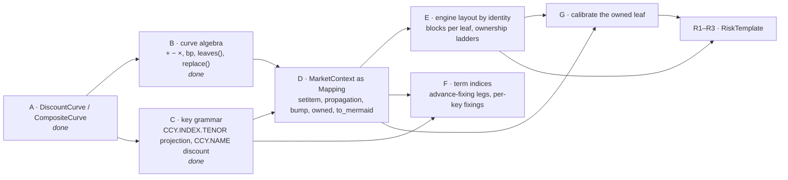

# Curves and market: the next book of work

> **Status: AGREED PLAN (2026-10-14, updated 2026-10-16).** Decisions taken in design discussion on
> `feature/carlos/more_curves`; PRs A and B are merged (#22), PR C is implemented on
> `feature/curve_grammar`, nothing else is.
> Companion to [risk_and_engine_design.md](risk_and_engine_design.md) (the `RiskTemplate` that
> lands on top of this) and [curves/](curves/README.md) (the user-facing documentation).

## 0. Decisions, so they are not re-litigated

1. **Curves compose only as weighted sums in log-DF, through one class.** `ln DF = Σ wᵢ ln DFᵢ`.
   It is the one composition that keeps `ln DF` exactly affine in the parameters, which is the
   engine contract. Spreads, bases, turns, overlays all fit; nothing non-affine is admitted. A
   spread is `CompositeCurve({"base": a, "spread": b})`, not a class of its own (`SpreadCurve`
   was removed on 2026-10-14 as pure delegation).
2. **Finance vocabulary at the surface, engineering underneath.** Users write
   `market["USD.FEDFUND.ON"] = market["USD.SOFR.ON"] - 5 * bp`. The words atom, group, layout,
   definition, leaf never appear in a public signature or a report.
3. **Sharing is by object identity, declared by construction.** Writing `sofr - 5 * bp` already
   says the Fed Funds curve is built on `sofr`. The engine deduplicates parameter blocks by the
   identity of the leaf curves it reaches; no name-based definitions table.
4. **A registered name owns the parameters nobody else owns.** `ladder("USD.SOFR.ON")` is all
   SOFR pillar risk however it arrived; `ladder("USD.FEDFUND.ON")` is the basis. A leaf reached
   by several names belongs to the one reaching it by the shortest path; at equal depth a
   projection key beats a discount key; an equal-depth tie on an unregistered leaf is a bind-time error.
5. **Scenarios propagate.** Replacing or bumping a curve rebuilds every registered curve that
   contains it. "Bump SOFR" moves Fed Funds and leaves the basis alone, because that is what the
   definition says.
6. **Two key forms, told apart by slot count.** `CCY.INDEX.TENOR` is a projection curve
   (`USD.SOFR.ON`, `USD.CME-TERM-SOFR.3M`; the tenor is always present, `ON` for overnight).
   `CCY.NAME` is a discount curve: a funding or collateral regime or an issuer (`USD.STDCSA`,
   `GBP.USDSTDCSA` = SONIA plus cross-currency basis, `USD.UST`). This is Strata's discount-map /
   forward-map split written as keys. Leg labels use the projection grammar; the STDCSA alias
   table goes; every market registers its discount keys explicitly. Conventions are registered per **family** with its admissible tenors; the tenor is
   a parameter of the index instance, so the registry does not grow with tenors.
7. **On-the-run is a template, not a curve.** One fitted `USD.UST`; OTR is the instrument set
   used as knots and risk nodes. A second Treasury *fit* may be a second curve.
8. **A spread is a curve when it is a risk factor, a convention when it is contractual.**
9. **`MarketContext` becomes a `Mapping[str, DiscountCurve]`** (not a `dict` subclass) with
   assembly writes, immutable scenario copies, and `yield_curve(name)` kept as the resolved view
   the engines read. `CurveNamespace` and its version counters go.
10. **Second order needs nothing from `Line1d`.** `∂² ln DF/∂z² = 0`; Hessians are rank-one per
    discount factor from the affine rows. JAX stays a test oracle.

## 1. Dependency graph



A, B and C are done; D is next.

## 2. PRs

### PR A — protocol and composites (on `feature/carlos/more_curves`, commit now)

`DiscountCurve` protocol; `CompositeCurve` with labelled components; `ZeroCurve.constant`; `ZeroCurve.params`,
`with_params`, `scheme`; `YieldCurve` / `MarketContext` / Numba program consume the protocol
(`n_params`, `params`, `scheme`); `bumped_curve` refuses composites; 29 tests incl. engine
integration; `docs/curves/` (13 documents, snippets verified); conventions in CLAUDE.md (no
module `__all__`, numpydoc).

### PR B — curve algebra (done 2026-10-15)

- `finance.markets.curves.units`: `bp = 1e-4`, `pct = 1e-2`.
- On every `DiscountCurve`: `a + b` → `CompositeCurve({"base": a, "spread": b})` (left operand
  is the base); `a - b` → `CompositeCurve((a, b), (1, -1))`; `a ± float` → base plus
  `ZeroCurve.constant(±float, a.max_x)` labelled `spread`; `w * a` → weight; `-a`; `a * b` →
  `TypeError`. Operators *define* curves; moving parameters is `with_params` / the market's `bump`.
- Labels and `ZeroCurve.constant` landed in PR A; the operators (`_curve_impl/algebra.py`, a stateless mixin), `Leaf`, `leaves()` and `replace()` in PR B.
- `leaves()` → `tuple[Leaf]` (`curve`, accumulated `weight`, `columns`) on both classes and in the protocol;
  `replace(old, new)` → same structure with `old` substituted wherever it appears (identity).
- Tests (`test_curve_algebra.py`): algebra equals explicit construction; `leaves` of a three-deep chain;
  `replace` propagates through nesting and leaves unrelated objects shared.

### PR C — key grammar: projection and discount keys (done 2026-10-16, `feature/curve_grammar`)

**Grammar (settled 2026-10-15).** The slot count carries the kind of curve:

| form | kind | examples |
|---|---|---|
| `CCY.INDEX.TENOR` | projection: what a floating leg resets off; the tenor is always present, `ON` for overnight | `USD.SOFR.ON`, `USD.FEDFUND.ON`, `USD.CME-TERM-SOFR.3M`, `GBP.SONIA.ON` |
| `CCY.NAME` | discounting: a funding / collateral regime or an issuer; never a tenor, nothing resets off it | `USD.STDCSA`, `GBP.STDCSA`, `GBP.USDSTDCSA`, `USD.UST` |

Dots separate slots, hyphens are allowed inside a slot. This is Strata's `RatesCurveGroup`
split (discount curves keyed by currency and collateral, forward curves keyed by index) written
as keys. `GBP.USDSTDCSA` reads "GBP cashflows discounted under a USD-collateral CSA" and is
built as `market["GBP.SONIA.ON"] + xccy_basis`.

- `finance/conventions/keys.py`: `CurveKey(ccy, name, tenor: Term | None)`; `parse(str)` /
  `str()`; `kind` is `Projection` when a tenor is present, `Discount` otherwise; `ON` maps to the
  overnight tenor inside the parser only (`Term` is untouched). Validation: a projection key's
  family must be registered and must list the tenor; a discount key needs no conventions.
- `IndexFamily(day_count, fixing_calendar, fixing_type, publication_lag, tenors: tuple[Term, ...])`
  replaces the per-index `RateIndex` conventions; `RateIndex` = family + one tenor via
  `registry.index(ccy, name, tenor)` (overnight families have the single tenor `ON`).
- `SwapConventions.float_frequency` gains `MATCH_TENOR`.
- Register `("USD", "CME-TERM-SOFR")` with tenors `1M 3M 6M 12M`, fixing in advance, Act/360.
- `curve_name(ccy, index, tenor)` for projection keys; `funding_curve_name(ccy, funding_id)` is
  literally `f"{ccy}.{funding_id}"`: the `_FUNDING_ALIASES` table (STDCSA → SOFR) is deleted.
  Discounting at SOFR is `market["USD.STDCSA"] = market["USD.SOFR.ON"]`, the same object under two
  keys; the identity layout (PR E) gives it one parameter block.
- **One grammar for leg labels.** `CommonInstrument.rate_index` holds the projection key string
  (`"USD.SOFR.ON"`, `"USD.CME-TERM-SOFR.3M"`); `projection_curve_name` is `CurveKey.parse`; the
  `"USD SOFR"` space label is retired. Builders accept `rate_index="SOFR"` (→ `.ON`) and
  `"CME-TERM-SOFR.3M"` for convenience and normalise to the key.
- Bonds carry `funding_id="UST"` → `USD.UST`; the Treasury curve is a discount key with no index.
- **Ownership tie-break at depth zero (feeds PR D/E).** When one object is registered under
  several keys at the same depth, a projection key owns it; discount keys own only what they add
  on top. So `ladder("USD.SOFR.ON")` is all SOFR pillar risk and `ladder("USD.STDCSA")` is empty
  for plain SOFR discounting and is the CSA spread when there is one.
- **No implicit discounting.** A market must register the discount key a trade's `funding_id`
  names; there is no default from `STDCSA` to the currency's overnight index. The explicit key is
  the point.
- Price indices (inflation) are not placed yet; when needed, a reserved tenor word such as
  `USD.CPI.INDEX` keeps the three-slot rule.

**Inventory (sweep of 2026-10-15, `7b499c9`).** Everything that spells a curve key or reads a
`RateIndex` field outside tests:

| where | what it does today | change |
|---|---|---|
| `instruments/resolution/resolver.py:15,26,40,45` | `curve_name(ccy, index)` → `CCY.INDEX`; `_FUNDING_ALIASES[STDCSA] = {"USD": "SOFR", "EUR": "ESTR"}` | `curve_name` gains `tenor`; alias table deleted, `funding_curve_name` is the two-slot key |
| `markets/curves/yield_curve.py:128` | `name = f"{index.currency}.{index.name}"` | `str(CurveKey)`; a discount-key `YieldCurve` has no `RateIndex` (`conventions` optional, only projection keys consult it) |
| `pricing/pricers/legs.py:43-49` | `projection_curve_name` parses the leg's `rate_index` label `"USD SOFR"` | `CurveKey.parse` |
| `pricing/pricers/legs.py:84-87`, `pricers/futures.py:47-48`, `pricers/swaption.py:93` | `curve_name(instrument.currency, instrument.index_name)` | projection key with the instrument's tenor; discount via `funding_curve_name` unchanged in shape |
| `instruments/resolution/builders.py:133,284`, `resolution/futures.py:99`, `swaption.py:46` | write `rate_index=idx.label` = `"USD SOFR"` onto legs | write the projection key string |
| `pricing/calibration/instruments.py:217-276` | helpers take `rate_index="SOFR"` and call `curve_name(currency, rate_index)` | normalise through `CurveKey` |
| `conventions/rate_index.py:44` `FundingIndex` | unused stub | delete (design §6.1) |
| `conventions/convention_registry.py` | key `(ccy, index)` | key per family; `index(ccy, name, tenor)` added |
| `conventions/definitions.py` | `_usd_overnight_market(index_name)` builds a `RateIndex` with `tenor=None` | overnight `IndexFamily` with tenors `("ON",)` |
| `markets/context.py` / test fixtures | markets register `USD.SOFR` only; swaps discount through the alias | every market also registers its discount key (`USD.STDCSA`); 24 `MarketContext(...)` sites, mostly tests |
| `quant_toolkit_xl/api.py:71,98` and README | `rate_index=str(rate_index)`, `curve_name(currency, index)` | accept the grammar; register the discount key; README examples |
| tests | 21 files spell `"USD.SOFR"` / `"USD.FEDFUND"` / `rate_index="SOFR"` | `"USD.SOFR"` → `"USD.SOFR.ON"` (or `curve_name(...)`); add the discount-key registration |

Gate: suite green; a Fed Funds swap (`USD.FEDFUND.ON` projection, `USD.STDCSA` discounting)
prices identically to today; `GBP.USDSTDCSA = GBP.SONIA.ON + xccy` discounts a GBP leg and
reports the basis under the discount key only (needs PR E for the ladder).

**As built (2026-10-16).** Everything above landed; the deltas from the spec, so D/E/F start from
the right picture:

- `finance/conventions/keys.py`: `CurveKey` (value equality and hash, because `Term` is
  unhashable), `CurveKind`, `OVERNIGHT = Term(1, Days)`, `parse_tenor` / `tenor_label`.
  `IndexFamily` (upper-cased, validated tenors, `index(tenor)`), `RateIndex(family, tenor)` with
  `key` / `label` = `'USD.SOFR.ON'`. `MarketConventions.family` replaces `.index`;
  `MarketConventions.index(tenor)` is the method. `MATCH_TENOR` is a sentinel enum member usable
  on `FloatLegConventions.payment_frequency` / `reset_frequency`, resolved per `RateIndex` by
  `float_leg_payment_frequency(index)` / `float_leg_reset_frequency(index)`
  (`frequency_for_tenor`). `ConventionRegistry.get` ignores a tenor suffix; `index(ccy, name, tenor)`,
  `key(...)`, `validate(key)` added; `FundingIndex` deleted.
- **CME Term SOFR** is registered with `FixingType.Arrears`, not `Advance`: in this library
  `FixingType` is the reset-*window* rule (`Advance` = the window ending at the accrual start, the
  "pay monthly, reset annually in advance" shape in `test_reset_grids`), and a forward-looking term
  rate projects over its own accrual period. The fixing *date* lag is not modelled yet (PR F). With
  `MATCH_TENOR` + `CouponType.Floating` a 3M Term SOFR swap already lowers to the simple-forward
  path and prices on both engines, so PR F's first bullet is done; F keeps per-key fixings and the
  basis tests.
- `YieldCurve(origin, zero_curve, key, conventions=None, fixings=None)`; `from_registry` /
  `build` take `key=` or `currency=`/`index_name=`; `with_key(...)`; `index` / `family` are `None`
  for a discount key and `RateGenerator.simple_rate` then requires an explicit `day_count`.
- `CurveNamespace.bind(curve, name=None)` / `rebind(curve, name=None)` / `names_of(curve)`:
  `ns.bind(sofr, "USD.STDCSA")` is today's spelling of `market["USD.STDCSA"] = market["USD.SOFR.ON"]`.
  `MarketContext.with_curve(curve, name=None)`: without `name` the curve "moved" and every key
  holding the replaced object follows (a `YieldCurve` sharing only the `zero_curve` object receives
  the new one under its own key); with `name` only that key changes. `curve_owner(name)` (projection
  key wins, else first bound) and `curve_aliases(name)` implement decision 4 at depth zero.
- **Part of PR E pulled forward.** `NumbaProgram` and `JaxProgram` lay parameters out per distinct
  registered curve *object* (`block_names`, named by `curve_owner`), so `USD.SOFR.ON` and
  `USD.STDCSA` are one block and risk under either key is the whole SOFR ladder; `compatible`
  also checks the sharing pattern. `NumbaAdjointResult.curve_param_slices` replaces
  `curve_param_offsets`; `JaxProgram.block(name)` maps a name to its block for `AutodiffRisk` and
  the JAX calibration Jacobian. PR E still owns the *leaf*-level layout (composites sharing an atom).
- `CurveDefinition.discount_keys: tuple[str, ...] = ()` — the discount keys the curve under
  calibration is bound under while its quotes price (`("USD.STDCSA",)` for a SOFR OIS from an
  empty market); `CurveDefinition.bind(market, curve)` does the binding. Nothing is discounted
  implicitly, so this is required for a from-scratch OIS calibration.
- Excel: `qMarket(as_of, ccy, index, curve, funding_id="STDCSA")` binds the curve under both keys.
- Not touched: `ccy_indices/amrs/usd.py::DEFINED` (test-only data, still listed for deletion in
  the risk design §6.1), `markets/paths/` (housekeeping).

### PR D — `MarketContext` redesign (done 2026-10-15, `feature/market_context`)

```python
class MarketContext(Mapping[str, DiscountCurve]):
    as_of: Date; conventions: ConventionRegistry; vols: VolNamespace | None
    fixings: MutableMapping[str, HistoricalFixings]
    __setitem__(key, curve)        # key parsed/validated against the registry; origin = as_of
    yield_curve(key) -> YieldCurve # derived, cached per (key, curve identity); engines unchanged
    zero_curve(key) -> DiscountCurve
    with_curve(key, curve)         # immutable copy; replace(old, new) through every other entry
    bump(key, amount | vector)     # with_params on the owned leaf, then with_curve
    owned(key) -> DiscountCurve    # the leaf(s) this key owns (shortest-path rule)
    leaf_owner() -> dict[int, str] # id(leaf) -> owning key; raises on ambiguity
    to_mermaid() -> str            # registered keys as boxes, unregistered leaves as rounded nodes by label, weights on edges
    freeze() -> MarketContext      # store becomes MappingProxyType
```

- `__setitem__` rejects a curve that contains the curve it replaces (that is a redefinition, not a bump).
- Starting point from PR C: `CurveNamespace.bind(curve, name)` aliases, `with_curve(curve, name=None)`
  with its two semantics, `curve_owner` / `curve_aliases` at depth zero. `with_curve` propagates
  to keys holding the same object or the same `zero_curve`; `replace` through composites is this PR.
- `to_mermaid()` is derived from component references by the same walk `leaf_owner()` uses; no graph class, no graph library.
- Old constructor `MarketContext(as_of_date, curves=CurveNamespace)` accepted for one release
  with a deprecation warning; `as_of_date` kept as an alias of `as_of`.
- `YieldCurve.from_registry` / `build` stay as conveniences; users should not need them.
- `CurveNamespace` deleted after the test sweep (33 construction sites).
- Tests: Fed Funds and three-deep Term SOFR chains; `bump` propagation semantics exactly as
  [curves/04](curves/04_yield_curve.md) describes; ownership table; ambiguity error.
- As built (differences from the sketch above): `CurveNamespace` went outright rather than
  through a deprecation release (the old constructor could not survive without it);
  `as_of_date=` is accepted as an alias of `as_of`. `with_curve(key, curve)` propagates only
  when `key` owns the object it held (`curve_owner`); on an alias (`USD.STDCSA`) it rebinds that
  key alone, which is what the old `name=` form did. `with_curve(yield_curve)` alone keeps
  working (key from the curve). `with_fixings(key, fixings)` added, since fixings now live on the
  market. `owned(key)` returns a tuple of atoms (a key may own several: `{"smooth", "turn"}`).
  Ownership ambiguity is checked at bind time and the failed assignment is rolled back; bind base
  curves before the curves built on them. `__setitem__` and `with_curve` both reject a curve
  built on the one being replaced. Fixings assigned through a `YieldCurve` attach only under the
  curve's own key, not under an alias.

### PR E — engine parameter layout by identity (≈3 days)

- PR C already gives one block per distinct registered curve object (`NumbaProgram.block_names`,
  `JaxProgram.block`), so two keys on one object share a block. This PR goes one level down:
- `engines/numba/layout.py: ParamLayout` built from `market.leaf_owner()`: one block per leaf,
  `W` (registered key → leaf weights) from `leaves()`, `scatter(key, jac)` into leaf columns.
- `NumbaProgram`: query table rows scattered through the layout; `params_from_market` reads
  leaves once; `compatible` compares leaf `x` and `scheme` per owning key.
- `NumbaAdjointResult.curve_slice(key)` → the owned block; `instrument_gradient(key, role)`
  unchanged in signature; `ladder("USD.FEDFUND.ON")` is basis risk.
- `NumbaRisk.gamma(key)` over the owned block; cross-block gamma via `gamma(keys=...)`.
- `Sensitivities.bumped_curve` → `market.bump(key, ...)`; the `TypeError` guard goes.
- JAX oracle: unchanged scope (log-linear atoms only); a composite market raises as today.
- Gate: all existing adjoint tests bit-identical for single-atom markets; the Fed Funds swap of
  [curves/05](curves/05_risk_jacobian_hessian.md) §6 reports one SOFR ladder equal to the sum
  of today's two.

### PR F — term indices (≈2 days, after C and D)

- ~~Term-index floating legs lower to the simple-forward path~~ — done in PR C via
  `MATCH_TENOR` + `CouponType.Floating` (`USD.CME-TERM-SOFR.3M` swaps price on both engines).
  Left here: the fixing-date lag of a rate set in advance (today the fixing date is the period
  start), and whether `FixingType` should split into window rule and fixing-date rule.
- **Rate window from the index, fixing dates from the reset grid.** Today the single-fixing path
  projects a simple forward over the reset window (`reset_start → reset_end`); the index tenor is
  never read. That is right only when reset frequency equals the tenor. A leg indexed to
  `USD.CME-TERM-SOFR.1M` that resets annually and holds the rate (a system-of-record mortgage
  pattern) must fix the 1M rate once, not a 1Y forward off the 1M curve. PR F makes the rate window
  `[fixing_date, fixing_date + index.tenor]` on the index calendar and leaves the reset grid to say
  *when* a fixing is taken and how many coupons it governs. Aligned legs are unchanged, so the gate
  is bit-identity on every existing swap test. Odd index/reset pairings stay legal; they are not
  validated away.
- Per-key fixings in the market; `RateGenerator.simple_rate` reads the key's fixings.
- Tests: a 3M Term SOFR swap on `USD.CME-TERM-SOFR.3M = USD.SOFR.ON + s3m` has SOFR risk under
  SOFR and basis risk under the 3M key; 6M built on 1M shows three ladders.

### PR G — calibrate the owned leaf (≈2 days)

- `CurveDefinition(key, interpolation)`; `CurveCalibrator.calibrate` solves `market.owned(key)`
  with `with_params`, other leaves held; result assigned back with `market[key] = ...` semantics.
- Sequential basis calibration test: OIS → 1M basis → 6M/1M basis; joint calibration as the same
  loop over several leaves.
- `calibration_jacobian` columns are the owned leaf's parameters.

### PR R1–R3 — `RiskTemplate`

As specified in [risk_and_engine_design.md](risk_and_engine_design.md) §2.12, with
`PillarRisk.curves` being owning keys and `J_T` columns being leaf parameters. The LogCubicDF
calibration-Jacobian subtest that fails today (pre-existing, `test_curve_calibrator.py:153`)
is fixed or explained in R1, since R1 generalises that routine.

### Housekeeping (any time)

- Delete `markets/paths/` (design §6.1; its `__init__` is the only ruff failure in the tree).
- `pyproject.toml` ruff keys under `[tool.ruff.lint]` (deprecation warning on every run).

## 3. Order and rough effort

| # | PR | Days | Unblocks |
|---|---|---|---|
| 1 | A commit | — | everything |
| 2 | B algebra (done) | 1 | D |
| 3 | C keys: projection / discount (done) | 2–3 | D, F |
| 4 | D market | 3 | E, F, G |
| 5 | E layout + ownership | 3 | G, R |
| 6 | F term indices | 2 | — |
| 7 | G calibrate leaf | 2 | R |
| 8 | R1–R3 template | 3–4 | trading milestone |

About three weeks to the "one snapped SOFR family, par-swap template, Fed Funds and Term SOFR
bases as their own ladders" milestone. Bonds, Treasury futures and the op-graph engine follow
per the risk design document and are unaffected by anything here except that they key curves by
`CurveKey`.
